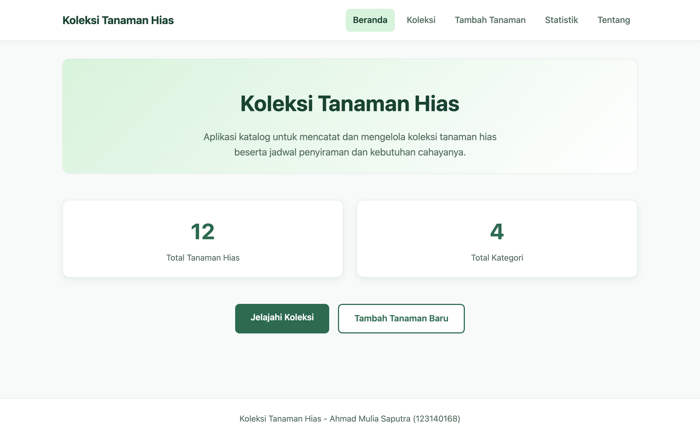
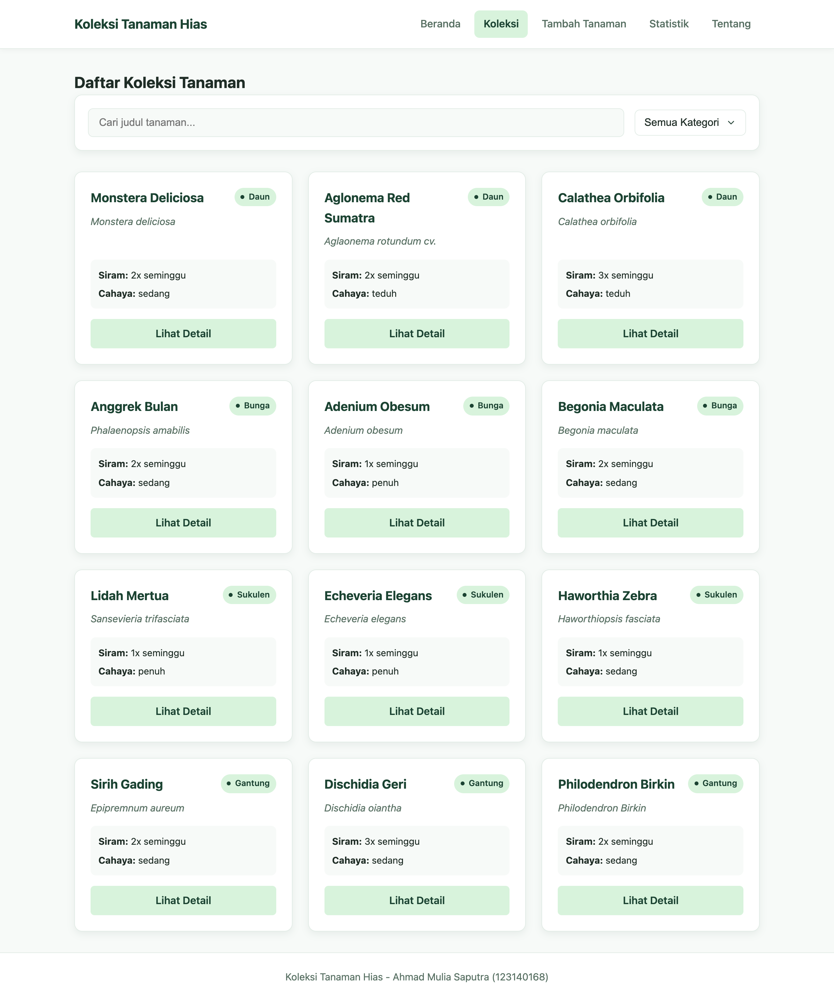
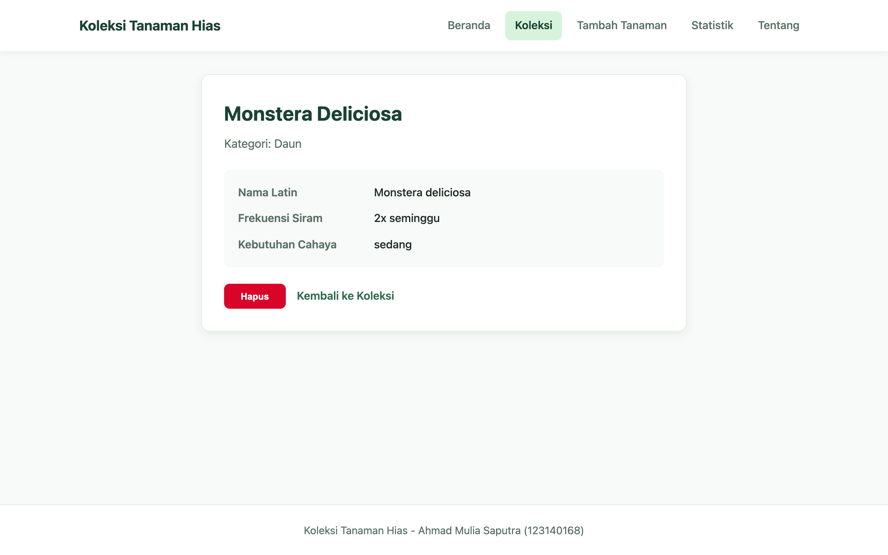
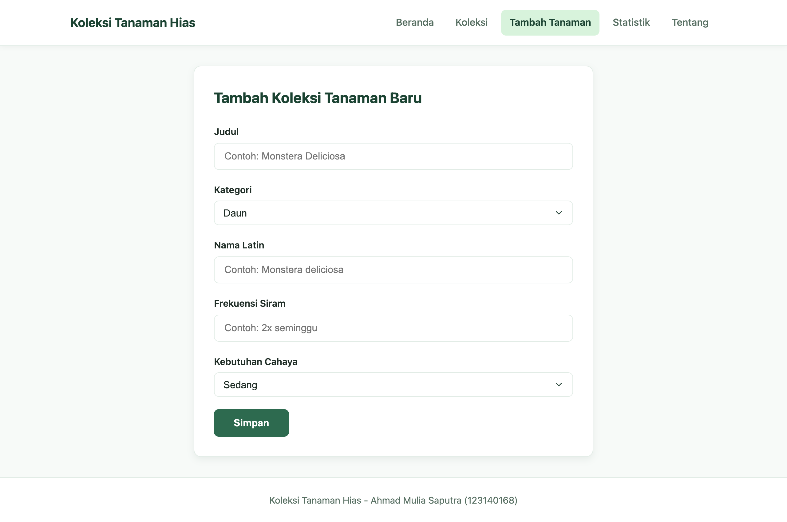
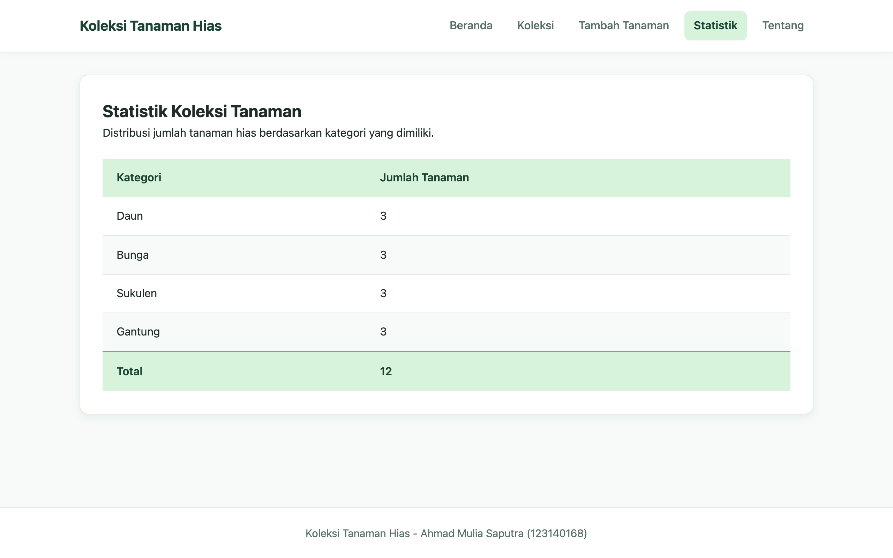
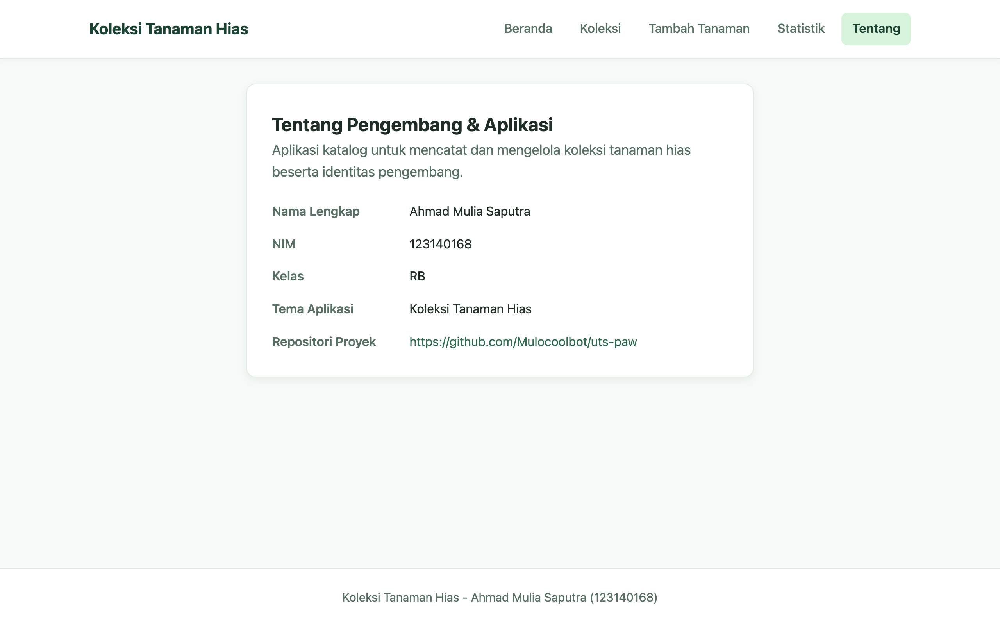

# Koleksi Tanaman Hias - UTS Pengembangan Aplikasi Web

Aplikasi web katalog untuk mencatat dan mengelola koleksi tanaman hias beserta jadwal penyiraman dan kebutuhan cahayanya. Proyek ini disusun untuk memenuhi tugas Ujian Tengah Semester (UTS) mata kuliah Pengembangan Aplikasi Web.

## Data Diri Mahasiswa

- **Nama**: Ahmad Mulia Saputra
- **NIM**: 123140168
- **Kelas**: RB (PAW RB)
- **Tema**: Koleksi Tanaman Hias

## Tautan Deployment

Aplikasi dapat diakses melalui GitHub Pages pada tautan berikut:

- https://mulocoolbot.github.io/uts-paw/

## Fitur Aplikasi

1. **Beranda (`/`)**
   Menampilkan deskripsi singkat aplikasi, ringkasan jumlah total tanaman hias dan jumlah kategori yang terdaftar, serta tombol pintasan menuju halaman daftar koleksi dan halaman tambah tanaman.

2. **Daftar Koleksi dengan Pencarian dan Filter Kategori (`/koleksi`)**
   Menampilkan daftar seluruh tanaman hias dalam bentuk kartu informasi. Pengguna dapat mencari tanaman berdasarkan kata kunci judul tanaman serta menyaring daftar berdasarkan kategori (`Daun`, `Bunga`, `Sukulen`, dan `Gantung`).

3. **Detail dan Hapus Tanaman (`/koleksi/:id`)**
   Menampilkan rincian satu tanaman hias yang meliputi judul tanaman, kategori, nama Latin, frekuensi siram, dan kebutuhan cahaya. Halaman ini juga menyediakan tombol untuk menghapus tanaman dari koleksi maupun kembali ke halaman daftar koleksi.

4. **Form Tambah Tanaman (`/tambah`)**
   Menyediakan formulir input untuk menambahkan data tanaman baru ke dalam koleksi dengan validasi input wajib pada nama tanaman. Data yang ditambahkan disimpan ke dalam `localStorage` peramban.

5. **Statistik Kategori (`/statistik`)**
   Menampilkan tabel rekapitulasi jumlah tanaman hias untuk setiap kategori beserta total keseluruhan koleksi tanaman.

6. **Halaman Tentang (`/tentang`)**
   Menampilkan informasi identitas mahasiswa pengembang aplikasi beserta tautan menuju repositori proyek.

## Tangkapan Layar (Screenshot)

### 1. Halaman Beranda


### 2. Halaman Daftar Koleksi


### 3. Halaman Detail Tanaman


### 4. Halaman Tambah Tanaman


### 5. Halaman Statistik


### 6. Halaman Tentang


## Cara Menjalankan Proyek di Komputer Lokal

Pastikan Node.js dan npm sudah terpasang di komputer sebelum menjalankan langkah berikut:

1. Masuk ke direktori aplikasi:
   ```bash
   cd app
   ```

2. Pasang seluruh dependensi proyek:
   ```bash
   npm install
   ```

3. Jalankan server pengembangan lokal:
   ```bash
   npm run dev
   ```
   Setelah server berjalan, buka alamat yang tertera di terminal (umumnya `http://localhost:5173`) pada peramban.

4. Perintah tambahan yang tersedia di dalam folder `app/`:
   - Menjalankan pengujian unit:
     ```bash
     npm test
     ```
   - Menjalankan pemeriksaan linter:
     ```bash
     npm run lint
     ```
   - Membuat bundel produksi:
     ```bash
     npm run build
     ```
   - Menjalankan skrip pemeriksa otomatis secara lokal:
     ```bash
     npm run cek
     ```
