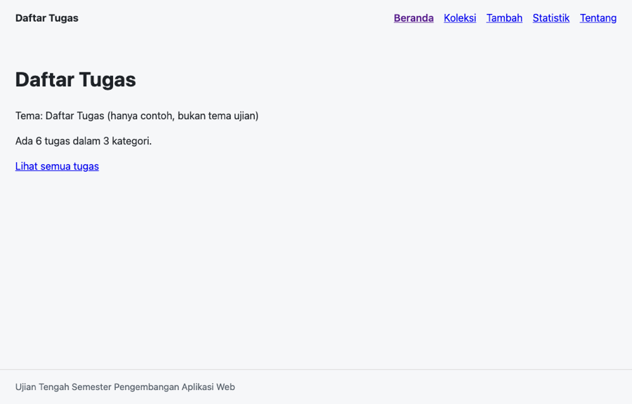

# Aplikasi Koleksi Tanaman Hias

Dokumentasi aplikasi web katalog dan manajemen koleksi tanaman hias untuk Ujian Tengah Semester mata kuliah IF25-22014 Pengembangan Aplikasi Web, Institut Teknologi Sumatera (ITERA).

## Identitas Mahasiswa

- **Nama**: Ahmad Mulia Saputra
- **NIM**: 123140168
- **Kelas**: RB
- **Tema**: Koleksi Tanaman Hias

## Deployment

Aplikasi telah di-deploy dan dapat diakses publik melalui GitHub Pages:
- **URL**: https://mulocoolbot.github.io/uts-paw/

## Tangkapan Layar



## Fitur Aplikasi

1. **Beranda (`/`)**:
   - Menampilkan judul utama aplikasi dan deskripsi ringkas katalog.
   - Ringkasan statistik cepat: total jumlah tanaman dan total kategori tanaman.
   - Tautan navigasi cepat ke halaman Koleksi dan Tambah Tanaman.

2. **Daftar Koleksi (`/koleksi`)**:
   - Menampilkan seluruh katalog tanaman hias dalam bentuk kartu visual modern (*grid layout*).
   - Fitur pencarian instan berdasarkan judul tanaman secara *case-insensitive*.
   - Filter dropdown dinamis berdasarkan kategori tanaman (*Semua*, *Daun*, *Bunga*, *Sukulen*, *Gantung*).
   - Penanganan status *loading* saat fetch data dan pesan saat item tidak ditemukan.

3. **Detail Tanaman (`/koleksi/:id`)**:
   - Menampilkan informasi lengkap tanaman: Judul, Kategori, serta 3 atribut spesifik tema:
     - **Nama Latin**
     - **Frekuensi Siram**
     - **Kebutuhan Cahaya**
   - Fitur hapus tanaman dengan konfirmasi yang memperbarui state dan `localStorage`, lalu mengarahkan kembali ke daftar koleksi.
   - Penanganan halaman saat id tidak ditemukan (pesan ramah tanpa error 404).

4. **Form Tambah Tanaman (`/tambah`)**:
   - Form terkontrol (*controlled components*) dengan validasi input.
   - Menolak submit jika judul kosong dan menampilkan pesan peringatan interaktif (`role="alert"`).
   - Menyimpan item baru secara persisten ke `localStorage` dengan ID unik berbasis timestamp.

5. **Statistik Koleksi (`/statistik`)**:
   - Menampilkan tabel ringkasan HTML semantik (`<thead>`, `<tbody>`, `<tfoot>`).
   - Perhitungan otomatis jumlah tanaman per kategori menggunakan `Array.prototype.reduce()`.
   - Menampilkan baris total keseluruhan item tanaman yang tersimpan.

6. **Halaman Tentang (`/tentang`)**:
   - Menampilkan profil lengkap mahasiswa (Nama, NIM, Kelas, Tema).
   - Tautan langsung ke repositori GitHub proyek.

7. **Halaman 404 (`*`)**:
   - Menampilkan pesan ramah saat pengguna mengakses rute yang tidak terdaftar disertai tautan kembali ke Beranda.

## Konsep React & Web Modern yang Diterapkan

- **Hooks**: `useState`, `useEffect`, `useContext`, `useCallback`, `useParams`, `useNavigate`.
- **Custom Hooks**:
  - `useLocalStorage`: Sinkronisasi state React dengan `window.localStorage`.
  - `useFilterTanaman`: Logika pemfilteran dan agregasi data statistik per kategori.
- **State Management**: React Context API (`KoleksiContext` & `KoleksiProvider`).
- **Routing**: `react-router-dom` v7 dengan 7 rute, `NavLink` aktif, dan `basename` GitHub Pages.
- **JavaScript Modern (ES6+)**: Destructuring, Spread Operator, Template Literals, `.map()`, `.filter()`, `.reduce()`.
- **Desain & Responsivitas**: CSS murni bertema botani hijau, CSS Grid, Flexbox, dan Media Queries mobile.

## Menjalankan Secara Lokal

Pastikan Node.js (versi 18 ke atas) telah terpasang di komputer Anda.

1. Masuk ke direktori aplikasi:
   ```bash
   cd app
   ```

2. Pasang dependensi proyek:
   ```bash
   npm install
   ```

3. Jalankan server pengembang lokal (Vite):
   ```bash
   npm run dev
   ```
   Buka peramban di `http://localhost:5173/uts-paw/`.

4. Jalankan linter (oxlint):
   ```bash
   npm run lint
   ```

5. Jalankan unit test (Vitest):
   ```bash
   npm test
   ```

6. Bangun bundel produksi:
   ```bash
   npm run build
   ```

7. Jalankan pemeriksaan rubrik otomatis:
   ```bash
   npm run cek
   ```
